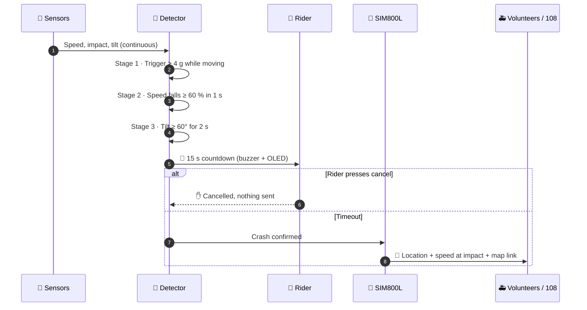
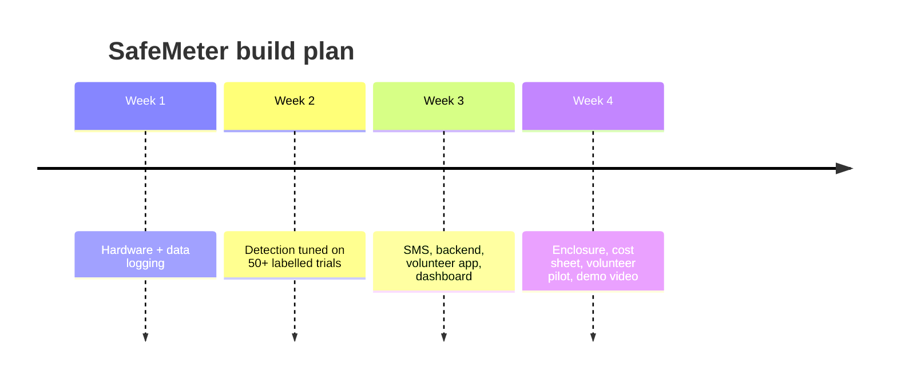

<div align="center">

# 🛡️ SafeMeter

### A vehicle-powered smart speedometer that detects crashes and summons help in the golden hour.

[](https://github.com/Vijay-3812/Safemeter/actions/workflows/ci.yml)


**No smartphone · No app · No internet · No rider action required.**

[**Why**](#-why) ·
[**How it works**](#-how-it-works) ·
[**Quick start**](#-quick-start) ·
[**Hardware**](#-hardware) ·
[**Real vs simulated**](#-whats-real-and-whats-simulated) ·
[**Roadmap**](#-roadmap) ·
[**Contribute**](#-contribute)

</div>

> 🏆 **SEVA submission** · Theme: *Surakshit Bharat* · Track A: Product or Technology

---

## ⚡ At a glance

SafeMeter is a low-cost retrofit unit for two-wheelers, autos, cabs and trucks. It sits beside the
existing speedometer, shows live speed, and continuously watches for crashes using
**wheel speed + impact force + orientation**. Not an accelerometer alone, so potholes don't trigger it.

When a crash is confirmed, the rider gets a **15-second cancel window**. If nobody cancels, an
**SMS with location, speed at impact and a map link** goes to family, nearby trained volunteers and
emergency services (108).

<table>
<tr>
<td align="center"><h3>📟</h3><b>Live speed</b><br/><sub>Beside the existing speedometer</sub></td>
<td align="center"><h3>🧠</h3><b>3-stage detector</b><br/><sub>Speed · impact · orientation</sub></td>
<td align="center"><h3>📩</h3><b>SMS over 2G</b><br/><sub>Works with no internet</sub></td>
<td align="center"><h3>🚑</h3><b>Volunteer dispatch</b><br/><sub>First to accept responds</sub></td>
</tr>
</table>

---

## 🎯 Why

India recorded **1,77,175 road deaths in 2024**; two-wheeler riders were **46.2 %** of them
(MoRTH, *Road Accidents in India 2024*).

Survival depends on the golden hour. On highways, at night and in rural areas:

- 🌙 nobody may be there to call
- 😵 the victim may be unconscious
- 📍 the location is hard to communicate

Phone apps and smart helmets fail exactly then, because they need a charged, worn, connected device.
**SafeMeter is powered by the vehicle and always on.**

---

## 🔬 How it works

### The crash timeline



### The three-stage detector

| Stage | Check | Rejects |
|:-----:|-------|---------|
| **1 · Trigger** | \|a\| ≥ 4 g while moving ≥ 20 km/h | parked knocks |
| **2 · Speed** | speed falls ≥ 60 % within 1 s | 🕳️ **potholes, speed breakers** (wheel keeps turning) |
| **3 · Orientation** | tilt ≥ 60° for 2 s (2W) / stationary 3 s (4W) | glancing hits, hard braking |

> All three must pass before the countdown starts.

<details>
<summary><b>🧪 Want to verify the detector yourself? (no hardware needed)</b></summary>

<br/>

The detector is a pure C++ state machine with
[11 native unit tests](firmware/test/test_native/test_crash_detector.cpp). Run them on your laptop:

```bash
cd firmware && pio test -e native
```

Scenarios covered:

- ✅ Normal riding never triggers
- ✅ Pothole is rejected by the speed check
- ✅ Speed breaker is rejected
- ✅ Hard braking never triggers
- ✅ Low-speed knock is ignored
- ✅ Two-wheeler full crash sequence
- ✅ Cancel button stops the alert
- ✅ Crash but stays upright is rejected
- ✅ Tilt must be continuous
- ✅ Four-wheeler uses the stationary check
- ✅ Reset clears everything

</details>

---

## 🗂️ Explore the repository

Click a row to jump into that part of the project.

| | Module | What's inside | Status |
|:-:|--------|---------------|:------:|
| 🔩 | [`firmware/`](firmware/) | ESP32 firmware (PlatformIO): speed sensor ISR, MPU6050 driver with vector complementary filter, GPS, non-blocking SIM800L SMS queue with store-and-forward, OLED UI, crash detector | ✅ compiles, detector unit-tested |
| ☁️ | [`backend/`](backend/) | Firebase Cloud Functions: device ingest, geo-matched volunteer dispatch via FCM, first-accept-wins transaction, response-time metrics; Firestore rules + indexes | ✅ written, needs a Firebase project |
| 📱 | [`volunteer-app/`](volunteer-app/) | Flutter responder app: register, availability, push → incident → navigate / call 108 / accept / arrived | ✍️ written, not yet built on device |
| 📊 | [`dashboard/`](dashboard/) | Static web dashboard: live incident table, Leaflet map, black-spot heatmap, response-time stats; demo mode without backend | ✅ works standalone |
| 🛠️ | [`tools/`](tools/) | Serial data logger, synthetic trace generator, threshold-vs-decision-tree evaluator | ✅ pipeline verified |
| 🔌 | [`hardware/`](hardware/) | Bill of materials with prices, wiring + power guide, bench test rig | 📄 documented |
| 📚 | [`docs/`](docs/) | Concept document, prototype description (markdown + original PDFs), architecture, detection notes, test plan, demo script, volunteer training, roadmap | 📄 documented |

---

## 🚀 Quick start

Pick the part you want to run:

<details open>
<summary><b>🔩 Firmware (ESP32)</b></summary>

<br/>

```bash
pip install platformio
cd firmware
cp include/secrets.example.h include/secrets.h   # add your emergency numbers
pio test -e native                                # run the crash-detector tests on your PC
pio run -e esp32dev -t upload                     # flash the board
pio device monitor                                # 115200 baud
```

**Serial monitor keys:** `L` log · `T` simulate impact · `C` cancel · `S` status

Wiring is in [`hardware/wiring.md`](hardware/wiring.md). The two things that break most builds
(SIM800L power and level shifting) are explained there.

</details>

<details>
<summary><b>☁️ Backend + 📊 Dashboard</b></summary>

<br/>

```bash
cd backend && npm --prefix functions install
firebase deploy --only functions,firestore:rules,firestore:indexes   # after setting .firebaserc
cd ../dashboard && python3 -m http.server 8000                       # demo mode until you paste a Firebase config
```

Open `http://localhost:8000` to see the dashboard. Without a Firebase config it runs in **demo mode**.

</details>

<details>
<summary><b>📱 Volunteer app (Flutter)</b></summary>

<br/>

```bash
cd volunteer-app && flutter create . --platforms=android,ios && flutterfire configure && flutter run
```

</details>

<details>
<summary><b>📈 Collect data and tune thresholds</b></summary>

<br/>

```bash
pip install -r tools/requirements.txt
python tools/data_logger/log_serial.py --port /dev/ttyUSB0 --label pothole --trial 1
python tools/analysis/evaluate.py data/raw        # confusion matrix: thresholds vs decision tree
```

</details>

---

## 🔌 Hardware

**Prototype cost: ≈ ₹ 2,000–2,900**

<details>
<summary><b>🧾 Show the parts list</b></summary>

<br/>

| Part | Role |
|------|------|
| ESP32 DevKit | Main controller |
| MPU6050 | Accelerometer + gyro (impact and tilt) |
| A3144 hall sensor + magnet | Wheel speed |
| NEO-6M GPS | Location and speed |
| SIM800L | SMS over 2G |
| 0.96" OLED | Live speed and countdown |
| Buzzer + button | Alert and cancel |
| LM2596 bucks ×2 (5 V and 4 V) | Power conversion from the vehicle |
| 1000 µF capacitor | Power smoothing |
| Enclosure | Housing (see `hardware/enclosure/`) |

Full BOM with a projected **₹ 1,500 cost at 1,000 units** and the production upgrade path
(ADXL375 high-g sensor, 4G module): **[`hardware/bom.md`](hardware/bom.md)**.

</details>

---

## 🧭 What's real and what's simulated

We'd rather be honest than impressive.

| ✅ Real and working | 🧪 Simulated / scaled down |
|---------------------|----------------------------|
| Sensor reading, speed calculation, tilt estimate | Crash forces (bench impacts ≪ real crashes) |
| Three-stage detection logic | Mounting on a moving vehicle |
| Countdown, cancel, SMS delivery | Large-scale volunteer coverage (pilot of 10–15) |
| App notification, dashboard logging | High-g sensing (production upgrade) |

<details>
<summary><b>⚠️ Known limitations</b></summary>

<br/>

- SIM800L is 2G (production → 4G).
- MPU6050 saturates at ±16 g.
- The unit can't tell if the rider is injured. That's why there is a cancel window and speed-at-impact in the SMS.
- GPS needs sky view and time to lock.

Details: [`docs/prototype-description.md`](docs/prototype-description.md).

</details>

---

## 🗺️ Roadmap



Full plan: [`docs/roadmap.md`](docs/roadmap.md).

---

## 🤝 Contribute

Thanks for helping make roads safer. Read [CONTRIBUTING.md](CONTRIBUTING.md) first. Three rules matter most:

1. 🛑 **Safety first.** Never run tests on a moving vehicle with a person on it. Bench rigs and padded drops only.
2. 🔐 **No secrets in git.** Phone numbers go in `firmware/include/secrets.h` (ignored).
3. 📏 **Honest numbers.** Results must come from real recordings in `data/raw/`.

<details>
<summary><b>🌱 Good first issues</b></summary>

<br/>

- [ ] Enclosure design (STL/STEP) in `hardware/enclosure/`
- [ ] Four-wheeler profile validation
- [ ] Multilingual SMS templates
- [ ] Flutter app: local notification channel setup, phone-number auth
- [ ] Dashboard: date-range filter, CSV export

</details>

---

## 👥 Team

**Team ZODIAC**

*Vijay Shree Karthik V · Sachin N · Nithyasri S · Preethica S · Sarvesh*
Sri Sairam Engineering College · vijayshreekarthik5@gmail.com

---

## 📄 License

[MIT](LICENSE). Hardware and documentation are shared under the same terms.

> ⚕️ Volunteer safety guidance in `docs/volunteer-training.md` is general first-responder advice, not
> medical instruction. Follow the directions of 108 and emergency services.

<div align="center">

**If SafeMeter could help someone you know, ⭐ star the repo and share it.**

</div>
