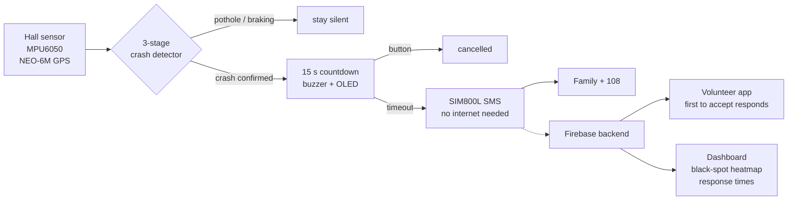

# SafeMeter

**A vehicle-powered smart speedometer that detects crashes and summons help in the golden hour.**

[](https://github.com/Vijay-3812/Safemeter/actions/workflows/ci.yml)


SafeMeter is a low-cost retrofit unit for two-wheelers, autos, cabs and trucks. It sits beside
the existing speedometer, shows live speed, and continuously watches for crashes using **wheel
speed + impact force + orientation** — not an accelerometer alone, so potholes don't trigger it.
When a crash is confirmed the rider gets a 15-second cancel window; otherwise an **SMS with the
location, speed at impact and a map link** goes to family, nearby trained volunteers and emergency
services. **No smartphone, app, internet or rider action required.**

> SEVA submission · Theme: Surakshit Bharat · Track A: Product or Technology

## Why

India recorded **1,77,175 road deaths in 2024**; two-wheeler riders were **46.2 %** of them
(MoRTH, *Road Accidents in India 2024*). Survival depends on the golden hour, but on highways, at
night and in rural areas nobody may be there to call, the victim may be unconscious, and the
location is hard to communicate. Phone apps and smart helmets fail exactly then — they need a
charged, worn, connected device. SafeMeter is powered by the vehicle and always on.

## How it works



| Stage | Check | Rejects |
|-------|-------|---------|
| 1 · Trigger | \|a\| ≥ 4 g while moving ≥ 20 km/h | parked knocks |
| 2 · Speed | speed falls ≥ 60 % within 1 s | **potholes, speed breakers** (wheel keeps turning) |
| 3 · Orientation | tilt ≥ 60° for 2 s (2W) / stationary 3 s (4W) | glancing hits, hard braking |

All three must pass before the countdown starts. The detector is a pure C++ state machine with
[11 native unit tests](firmware/test/test_native/test_crash_detector.cpp) you can run on your
laptop — no hardware needed.

## Repository

| Directory | What's inside | Status |
|-----------|---------------|--------|
| [`firmware/`](firmware/) | ESP32 firmware (PlatformIO): speed sensor ISR, MPU6050 driver with vector complementary filter, GPS, non-blocking SIM800L SMS queue with store-and-forward, OLED UI, crash detector | ✅ compiles, detector unit-tested |
| [`backend/`](backend/) | Firebase Cloud Functions: device ingest, geo-matched volunteer dispatch via FCM, first-accept-wins transaction, response-time metrics; Firestore rules + indexes | ✅ written, needs a Firebase project |
| [`volunteer-app/`](volunteer-app/) | Flutter responder app: register, availability, push → incident → navigate / call 108 / accept / arrived | ✍️ written, not yet built on device |
| [`dashboard/`](dashboard/) | Static web dashboard: live incident table, Leaflet map, black-spot heatmap, response-time stats; demo mode without backend | ✅ works standalone |
| [`tools/`](tools/) | Serial data logger, synthetic trace generator, threshold-vs-decision-tree evaluator | ✅ pipeline verified |
| [`hardware/`](hardware/) | Bill of materials with prices, wiring + power guide, bench test rig | 📄 |
| [`docs/`](docs/) | Concept document, prototype description (markdown + original PDFs), architecture, detection notes, test plan, demo script, volunteer training, roadmap | 📄 |

## Quick start

### Firmware (ESP32)

```bash
pip install platformio
cd firmware
cp include/secrets.example.h include/secrets.h   # add your emergency numbers
pio test -e native                                # run the crash-detector tests on your PC
pio run -e esp32dev -t upload                     # flash the board
pio device monitor                                # 115200 baud; L=log  T=simulate impact  C=cancel  S=status
```

Wiring is in [`hardware/wiring.md`](hardware/wiring.md); the two things that break most builds
(SIM800L power, level shifting) are explained there.

### Backend + dashboard

```bash
cd backend && npm --prefix functions install
firebase deploy --only functions,firestore:rules,firestore:indexes   # after setting .firebaserc
cd ../dashboard && python3 -m http.server 8000                       # demo mode until you paste a Firebase config
```

### Volunteer app

```bash
cd volunteer-app && flutter create . --platforms=android,ios && flutterfire configure && flutter run
```

### Collect data and tune thresholds

```bash
pip install -r tools/requirements.txt
python tools/data_logger/log_serial.py --port /dev/ttyUSB0 --label pothole --trial 1
python tools/analysis/evaluate.py data/raw        # confusion matrix: thresholds vs decision tree
```

## Hardware (prototype ≈ ₹ 2,000–2,900)

ESP32 DevKit · MPU6050 · A3144 hall sensor + magnet · NEO-6M GPS · SIM800L · 0.96" OLED · buzzer ·
button · two LM2596 bucks (5 V and 4 V) · 1000 µF cap · enclosure. Full BOM with projected
₹ 1,500 cost at 1,000 units and the production upgrade path (ADXL375 high-g sensor, 4G module):
[`hardware/bom.md`](hardware/bom.md).

## What's real and what's simulated

| Real and working | Simulated / scaled down |
|------------------|-------------------------|
| Sensor reading, speed calculation, tilt estimate | Crash forces (bench impacts ≪ real crashes) |
| Three-stage detection logic | Mounting on a moving vehicle |
| Countdown, cancel, SMS delivery | Large-scale volunteer coverage (pilot of 10–15) |
| App notification, dashboard logging | High-g sensing (production upgrade) |

Known limitations: SIM800L is 2G (production → 4G); MPU6050 saturates at ±16 g; the unit can't
tell if the rider is injured (hence the cancel window and speed-at-impact in the SMS); GPS needs
sky and time to lock. Details in [`docs/prototype-description.md`](docs/prototype-description.md).

## Roadmap

Week 1 hardware + logging → Week 2 detection tuned on 50+ labelled trials → Week 3 SMS, backend,
app, dashboard → Week 4 enclosure, cost sheet, volunteer pilot, demo video.
See [`docs/roadmap.md`](docs/roadmap.md).

## Team
*Team ZODIAC*
*Vijay Shree Karthik V, Sachin N, Nithyasri S, Preethica S, Sarvesh* — *Sri Sairam Engineering College* — *vijayshreekarthik5@gmail.com*

## License

[MIT](LICENSE) — hardware and documentation are shared under the same terms. Volunteer safety
guidance in `docs/volunteer-training.md` is general first-responder advice, not medical
instruction; follow the directions of 108 / emergency services.
