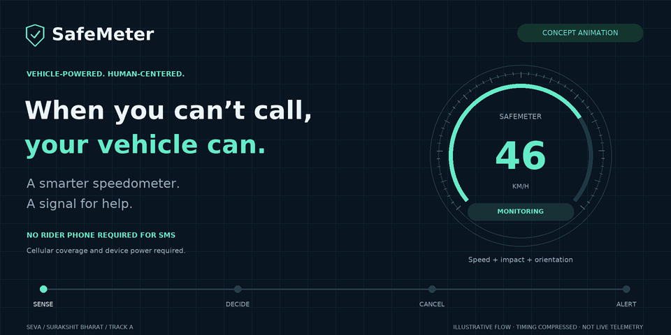
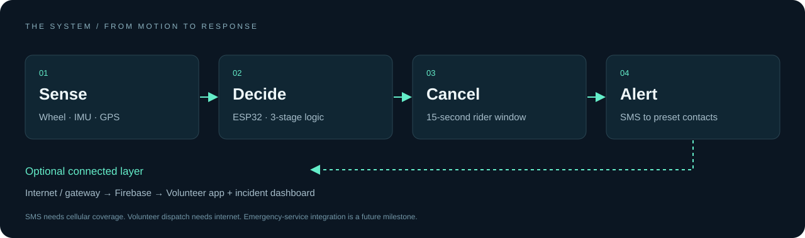
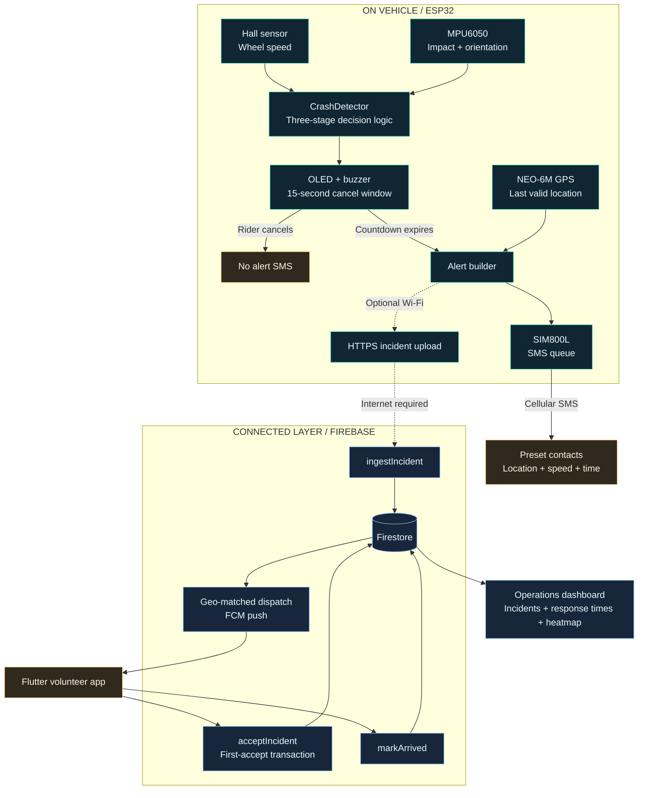
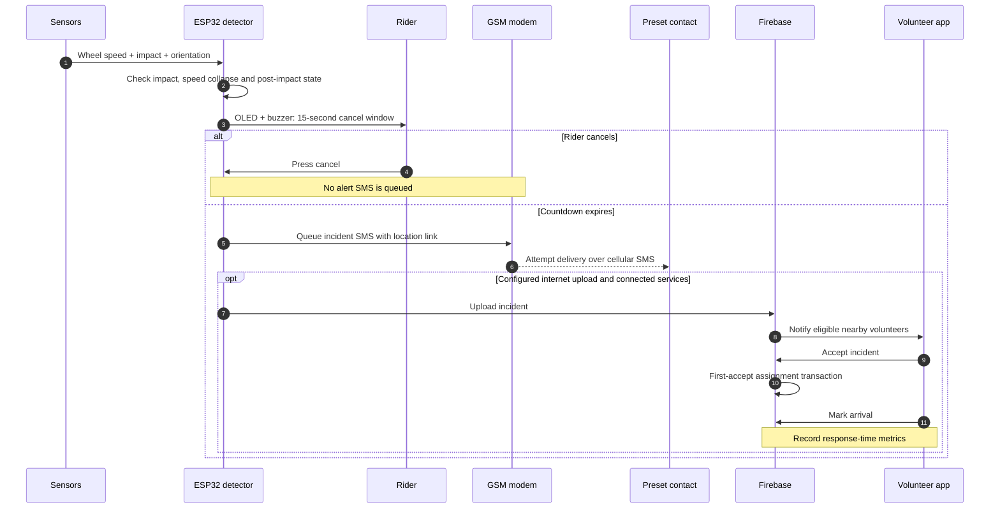
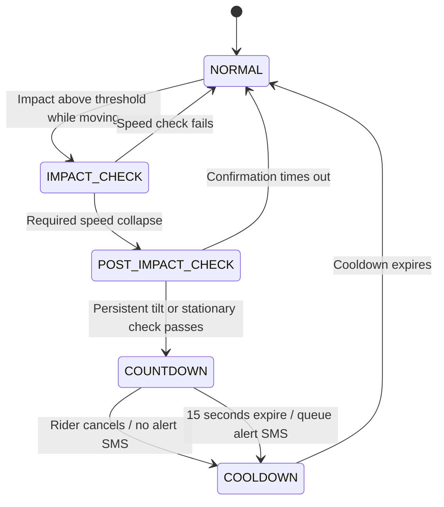
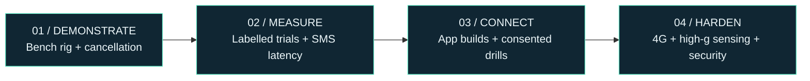

<div align="center">



<sub>Illustrative prototype flow · Timing compressed · Not live telemetry · [View the still version](docs/assets/safemeter-static.png)</sub>

**A vehicle-powered smart speedometer that detects possible crashes and sends a signal for help.**

[](https://github.com/Vijay-3812/Safemeter/actions/workflows/ci.yml)
[](LICENSE)
[](docs/project-status.md)
[](firmware/)

[**The idea**](#the-idea) · [**Try it**](#try-it-in-60-seconds) · [**Architecture**](#system-architecture) · [**Crash timeline**](#the-crash-to-contact-timeline) · [**Evidence**](docs/project-status.md) · [**Judge’s guide**](docs/judges-guide.md) · [**Docs**](docs/README.md)

<sub>SEVA submission · Surakshit Bharat · Track A: Product or Technology</sub>

</div>

> **New here?** Start with the [one-page judge’s guide](docs/judges-guide.md), open the dashboard demo, then inspect the [detector tests](firmware/test/test_native/test_crash_detector.cpp). The concept and detailed prototype PDFs are preserved in [`docs/`](docs/).

## Choose your route

| Your next stop | Start here | What you will find |
|:--|:--|:--|
| **Evaluate the idea** | [Judge’s guide](docs/judges-guide.md) | The problem, distinction and a three-minute review path |
| **Explore the system** | [Architecture below](#system-architecture) | Device, SMS, cloud and responder connections |
| **Run something now** | [Dashboard demo](#try-it-in-60-seconds) | Synthetic incidents, map exploration and status filters |
| **Inspect the engineering** | [Detector tests](firmware/test/test_native/test_crash_detector.cpp) | Replayable scenarios, cancellation and rejection cases |
| **Build the prototype** | [Hardware guide](hardware/README.md) | Wiring, power, parts and a safe bench rig |

## The idea

### A speedometer for every ride. A voice when it matters.

After a crash, the rider may be unable to make a call. A bystander may not be there. Even when someone can help, describing the location can cost time.

**SafeMeter is designed to close the gap between an accident and someone knowing about it.** It sits beside the existing speedometer, draws power from the vehicle, and combines wheel speed, impact and orientation to identify a possible crash. After a **15-second cancel window**, it queues an SMS with a map link and incident details to preset contacts.

**The rider-side SMS path needs no smartphone or mobile data.** It still requires vehicle power, a working SIM and cellular SMS coverage. Connected volunteer dispatch is a separate, internet-dependent layer—not magic offline cloud connectivity.

<table>
<tr>
<td width="33%" valign="top"><h3>01 / Sense with context</h3>Not just an impact spike. Check whether wheel speed collapsed and the vehicle remained tilted.</td>
<td width="33%" valign="top"><h3>02 / Keep the rider in control</h3>A visible, audible countdown gives the rider a chance to cancel before an alert is sent.</td>
<td width="33%" valign="top"><h3>03 / Connect to people</h3>SMS to preset contacts; optional cloud dispatch to nearby volunteers and response-time tracking.</td>
</tr>
</table>

## Try it in 60 seconds

**No hardware or Firebase account required.** With Node.js 22.19+ and pnpm 10.6.2 installed, run from the repository root:

```bash
cd dashboard
pnpm install --frozen-lockfile
pnpm dev
```

Open **http://localhost:5173**. The operations console generates **seeded synthetic incidents along Chennai road corridors**. Explore the incident list, select a status filter, click a row to focus the map, and toggle the heatmap.

> This is a **UI demonstration**, not a live emergency feed or proof of device-to-cloud delivery. Fonts and icons are self-hosted. CARTO basemap tiles need internet; if unavailable, a labelled schematic incident layer remains usable. For the hosted Arena preview, use its preview URL rather than localhost.

**Want to test the actual decision logic?** See [native detector tests](#run-the-detector-tests). Want the full bench presentation? Use the [demo runbook](docs/demo-script.md).

## Under the hood



### System architecture

**One device. Two communication paths.** SMS to preset contacts is the primary alert path; internet-connected services add responder coordination and visibility.



> **Read the arrows carefully:** the SIM800L does not send Firebase push notifications. The connected flow needs a separately configured internet upload. No emergency-service integration or guaranteed delivery is implied.

### The crash-to-contact timeline

The intended sequence below shows both the **cancel path** and the **alert path**. Connected steps require deployment and configuration; this is an architecture walkthrough, not a recorded successful field test.



### Three checks. Then a chance to cancel.

| Gate | Prototype rule | Why it exists |
|:--|:--|:--|
| **01 · Impact** | ≥ 4 g while moving ≥ 20 km/h | Ignore low-speed knocks in the configured scenarios |
| **02 · Speed collapse** | ≥ 60% speed drop over a 1-second check window | Reject a jolt when the wheel keeps turning |
| **03 · Post-impact state** | Two-wheeler: ≥ 60° tilt held for 2 seconds | Seek persistent evidence beyond the impact |
| **04 · Rider decision** | 15 seconds to cancel | Give conscious riders a way to stop an unwanted alert |

The four-wheeler profile uses a stationary check instead of tilt. These are **tunable bench-prototype thresholds**, not validated safety limits. Upright crashes, low-speed incidents and unusual wheel behaviour can be missed. See [detection design and gaps](docs/crash-detection.md).

<details>
<summary><strong>What does the alert look like?</strong></summary>

Illustrative message, not a delivery receipt:

```text
SAFEMETER CRASH ALERT
SM-001 2026-10-14 08:30:15Z
Speed 48km/h Impact 6.2g
https://maps.google.com/?q=12.934512,80.207812
Call 108 if unreachable
```

SMS goes to configured recipients. **“Call 108” is guidance in the message, not an implemented integration with emergency services.** Use only consenting team-owned numbers in demonstrations.

</details>

<details>
<summary><strong>Engineering deep dive / open the detector state machine</strong></summary>



The two-wheeler profile checks persistent tilt; the four-wheeler profile checks stationary duration. Rejected events return to normal operation. Both cancelled and alerted events enter a cooldown to avoid immediate retriggers.

[Read the portable C++ implementation](firmware/lib/CrashDetector/CrashDetector.cpp) · [Inspect all tunable parameters](docs/crash-detection.md)

</details>

<details>
<summary><strong>Demo challenge / can the detector tell these scenarios apart?</strong></summary>

| Bench scenario | Expected configured behaviour | Inspect |
|:--|:--|:--|
| Jolt while the wheel keeps spinning | Reject at the speed check | Pothole replay |
| Braking without a qualifying impact | Remain in normal operation | Hard-braking replay |
| Impact + wheel-speed collapse + sustained tilt | Enter the cancellation countdown | Two-wheeler crash replay |
| Cancel button during the countdown | Do not emit an alert event | Cancellation replay |
| Impact and speed collapse, but bike stays upright | Reject after post-impact confirmation times out | Upright-crash rejection replay |

These expectations come from the [synthetic replay suite](firmware/test/test_native/test_crash_detector.cpp), not measured road performance. The last scenario also illustrates a real limitation: an upright crash can be missed.

Use the [safe demo runbook](docs/demo-script.md) for a physical demonstration. Never stage a crash with a rider.

</details>

[Architecture & sequences →](docs/architecture.md) · [Detector implementation →](firmware/lib/CrashDetector/) · [Backend schema →](backend/schema.md)

## Built to be inspected

A strong prototype makes its boundaries visible. Source code is not a field trial, and synthetic data is not a safety result.

| Component | In this repository | What still needs evidence |
|:--|:--|:--|
| **Device firmware** | ESP32 sensors, detector, OLED, cancel flow, SMS queue | Physical assembly, calibration, measured SMS delivery and resilience |
| **Detection core** | Hardware-independent C++; 11 synthetic replay unit tests | Labelled bench trials and eventual professionally supervised field validation |
| **Response backend** | Firebase ingest, geo-dispatch, first-accept transaction | Deployment, access-control review, end-to-end integration tests |
| **Volunteer app** | Flutter screens, notifications and responder flow | Generated platform configuration, device builds and pilot drills |
| **Operations dashboard** | Demo data, incident map, status filtering and heatmap | Authenticated live deployment and privacy controls |
| **Analysis tools** | Serial logger, synthetic traces, threshold/classifier evaluation | Real measurements; no claimed detection accuracy yet |

**Not claimed:** certified crash detection, guaranteed rescue, confirmed 108 integration, production-ready security, or measured lives saved. The [evidence register](docs/project-status.md) explains what would substantiate each claim.

## Build your path

### Run the detector tests

Requires Python 3, PlatformIO and a native C++ toolchain. The first run downloads PlatformIO dependencies.

```bash
python3 -m venv .venv
source .venv/bin/activate            # Windows: .venv\Scripts\activate
python -m pip install platformio
cd firmware
pio test -e native
```

The suite covers ordinary riding, potholes, speed breakers, hard braking, low-speed knocks, crash progression, cancellation, upright rejection, continuous tilt, the four-wheeler profile and reset.

### Assemble the hardware

**Indicative prototype BOM: ₹1,900–2,900**, not a supplier quote; recurring SIM costs and demo-rig extras are listed separately in the [cost sheet](hardware/bom.md).

| Compute | Motion & speed | Location & comms | Rider interface |
|:--|:--|:--|:--|
| ESP32 DevKit | MPU6050 + hall sensor/magnet | NEO-6M GPS + SIM800L | OLED + buzzer + cancel button |

Start with the [wiring guide](hardware/wiring.md) and [safe test rig](hardware/test-rig.md). **Give the SIM800L its own ~4 V supply** with burst-current headroom; never power it from the ESP32’s 3.3 V pin.

```bash
# From firmware/ with the virtual environment active
cp include/secrets.example.h include/secrets.h
# Edit secrets.h locally: use consenting test recipients only.
pio run -e esp32dev
pio run -e esp32dev -t upload
pio device monitor
```

<details>
<summary><strong>Continue into the connected stack</strong></summary>

- **[Backend setup](backend/README.md):** configure your Firebase project, install function dependencies, review rules and device keys, then deploy. Cloud resources may incur charges.
- **[Volunteer app setup](volunteer-app/README.md):** Flutter SDK, generated Android/iOS platform projects and Firebase configuration are required. This is not a prebuilt app download.
- **[Dashboard setup](dashboard/README.md):** starts in demo mode; a typed API/WebSocket source stub is provided for a future connected backend. Review authentication before deployment.
- **[Analysis workflow](tools/README.md):** label recordings and compare threshold logic with a small decision tree. Keep synthetic and measured datasets separate.

</details>

## The repository, at a glance

```text
SafeMeter
├── firmware/        ESP32 firmware + portable C++ detector + replay tests
├── hardware/        Wiring, cost model, enclosure notes and safe bench rig
├── backend/         Firebase functions, Firestore rules and incident schema
├── volunteer-app/   Flutter responder experience
├── dashboard/       Incident operations UI with synthetic demo mode
├── tools/           Serial capture, trace generation and analysis
├── data/            Dataset conventions, not claimed field results
└── docs/            Architecture, original PDFs, evidence and demo guides
```

## From prototype to deployment



*Planned progression, not completed milestones. Each stage needs its own evidence.*

**Now →** Demonstrate the decision logic and cancellation safely.

**Next →** Record labelled bench trials, measure SMS latency, build the app and run consented responder drills.

**Then →** Upgrade to high-g sensing and 4G, automotive power protection, secure provisioning and privacy-reviewed deployments.

The [roadmap](docs/roadmap.md) is a plan, not a list of completed milestones. SIM800L depends on 2G availability; MPU6050 saturates at ±16 g; vehicle power loss, stale GPS and network outages remain important failure modes.

## Help build the next mile

Hardware builders, embedded developers, Flutter contributors, data analysts and documentation writers are welcome.

- Read the [contribution guide](CONTRIBUTING.md) for setup and review expectations.
- Choose a starter task: multilingual alert copy, accessible dashboard controls, enclosure CAD, or reproducible bench-test reporting.
- Report reproducible problems using the [issue templates](https://github.com/Vijay-3812/Safemeter/issues/new/choose).
- For vulnerabilities, follow the [security policy](SECURITY.md). For community expectations, see the [code of conduct](CODE_OF_CONDUCT.md).

> **Safety first.** Bench rigs and padded controlled tests only. Never stage a crash with a rider, send test alerts to emergency-service numbers, or publish personal locations and phone numbers. SafeMeter is a research prototype—not a replacement for emergency services or a certified safety system.

---

<div align="center">

**Built for the ride. Designed for the moment after.**

[Concept PDF](docs/SafeMeter_Concept_Document.pdf) · [Prototype PDF](docs/SafeMeter_Prototype_Detailed_Description.pdf) · [Documentation hub](docs/README.md) · [MIT license](LICENSE)

<sub>SafeMeter · Vijay Shree Karthik & the SafeMeter team</sub>

</div>
