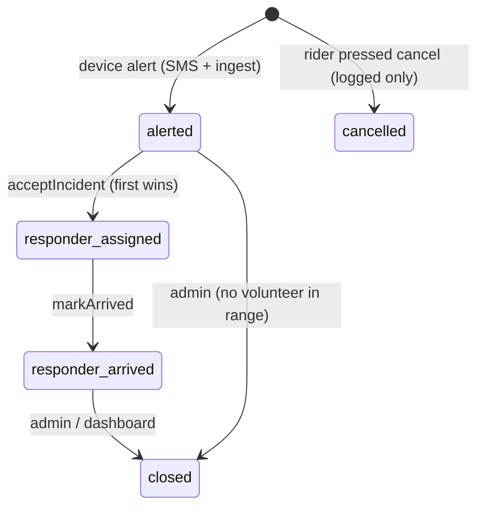

# Firestore data model

Three collections. All timestamps are Firestore `Timestamp`s written by the server.

## `devices/{vehicleId}`

One document per SafeMeter unit. Created by an admin (console or script), never by clients.

| Field        | Type   | Notes                                              |
|--------------|--------|----------------------------------------------------|
| `apiKey`     | string | Random secret the device sends as `x-device-key`   |
| `ownerName`  | string | Rider / fleet name shown to responders             |
| `ownerPhone` | string | So a responder can call the rider                  |
| `vehicleType`| string | `two_wheeler` \| `four_wheeler`                    |
| `createdAt`  | ts     |                                                    |

```js
// Example: create a device from the Node admin SDK
await db.collection("devices").doc("SM-001").set({
  apiKey: crypto.randomBytes(24).toString("hex"),
  ownerName: "Demo Rider", ownerPhone: "+919999999999",
  vehicleType: "two_wheeler", createdAt: FieldValue.serverTimestamp(),
});
```

## `incidents/{incidentId}`

Written by `ingestIncident`; status advanced by `acceptIncident` / `markArrived`.

| Field                  | Type        | Notes                                                        |
|------------------------|-------------|--------------------------------------------------------------|
| `vehicleId`            | string      |                                                              |
| `status`               | string      | `alerted` → `responder_assigned` → `responder_arrived` → `closed`, or `cancelled` |
| `lat`, `lon`           | number/null | Last known GPS fix                                           |
| `geohash`              | string/null | For geo queries / heatmap                                    |
| `gpsAgeMs`             | number/null | How stale the fix was at alert time                          |
| `speedKmh`             | number      | Speed before impact                                          |
| `peakG`                | number      | Peak acceleration magnitude                                  |
| `maxTiltDeg`           | number      |                                                              |
| `deviceTimestampUtc`   | string      | GPS time from the device                                     |
| `createdAt`            | ts          | Server receive time (reference for all response metrics)     |
| `notifiedCount`        | number      | Volunteers successfully pushed                               |
| `notifiedVolunteerIds` | string[]    |                                                              |
| `responderId`          | string/null | UID of the volunteer who accepted                            |
| `acceptedAt`           | ts/null     |                                                              |
| `timeToAcceptSec`      | number      | `acceptedAt - createdAt`                                     |
| `arrivedAt`            | ts/null     |                                                              |
| `timeToArriveSec`      | number      | `arrivedAt - createdAt`                                      |

## `volunteers/{uid}`

Owned by the signed-in volunteer (Firebase Auth UID).

| Field       | Type    | Notes                                          |
|-------------|---------|------------------------------------------------|
| `name`      | string  |                                                |
| `phone`     | string  |                                                |
| `available` | bool    | Toggle in the app; only available volunteers are paged |
| `lat`, `lon`| number  | Updated when the app opens / periodically      |
| `geohash`   | string  | geofire-common geohash of `lat,lon`            |
| `fcmToken`  | string  | Push token; cleared automatically when dead    |
| `trained`   | bool    | Completed the short training module            |
| `updatedAt` | ts      |                                                |

## Status flow


