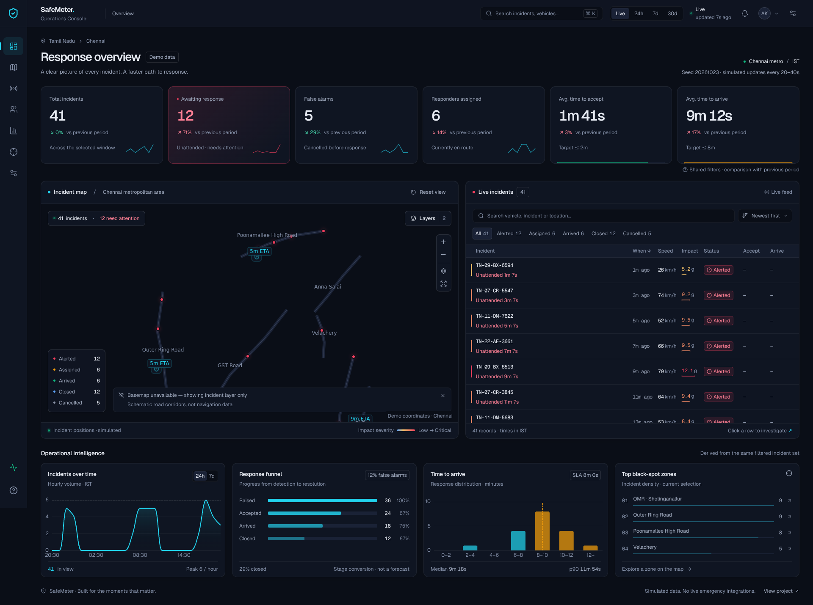

# SafeMeter / Operations Console

An interactive Chennai road-safety response **simulation**. Designed for incident triage, investigation and response analysis—not connected to emergency services.

## Run

Requires **Node.js 22.19+** and **pnpm 10.6.2**. Direct dependencies are exact-pinned; the lockfile pins transitive resolution.

```bash
cd dashboard
pnpm install --frozen-lockfile
pnpm dev
```

Open http://localhost:5173. Use the live-preview URL instead when running in Arena. Both dev and preview bind to `0.0.0.0` and permit `.e2b.app` preview hosts.

```bash
pnpm build
pnpm preview                        # http://localhost:4173
```

### Deploy as your hackathon project link

Deploy **`dashboard/dist/`**, not the raw source folder. For Netlify/Vercel/Cloudflare Pages, set the project root to `dashboard`, build command to `pnpm build`, and output directory to `dist`. Use Node 22.19+ and install from the frozen lockfile. No API keys or Firebase account are needed for the simulation. No client routes require server rewrites.

For GitHub Pages or a subdirectory host, configure Vite's `base` for that path (for example `pnpm exec vite build --base=/Safemeter/`). The favicon uses Vite's base-aware HTML URL. Do not treat the temporary Arena preview as a permanent public submission URL.

## Preview



*Screenshot: the offline-basemap state. Replace/update this capture after design changes; a capture with the internet basemap must still keep the Demo data label visible.*

## Features

- Six animated KPI cards, real previous-window comparisons, inline SVG trends, demo accept/arrival SLA indicators and shared status filtering.
- MapLibre + react-map-gl: CARTO Dark Matter, native severity-aware clustering with count symbols, active radar dots, native density heatmap and animated dispatch lines.
- Named Chennai road corridors, bounded coordinates, easing, fit/zoom/fullscreen, layer switches, simulated responders/ETAs and cross-highlighting.
- TanStack Table + Virtual: explicit CSS-grid tracks, keyboard row navigation, search, status facets, sorting and hover actions. Secondary columns collapse in narrow **containers**; full details remain in the drawer.
- Accessible Radix investigation drawer: location schematic, coordinate copy, OSM link, response timeline, masked demo contact information, telemetry illustration and JSON export.
- Local-only assign, advance, cancel and escalate actions. Session overrides survive subsequent simulated snapshots and reset on reload.
- ECharts with one token-derived theme: time series, response funnel, arrival histogram and clickable ranked zones.
- Ctrl/Cmd+K command palette; local preferences; paused simulation; optional critical-incident chime, muted by default; dismissible toast inbox.
- Self-hosted Geist/Geist Mono, Lucide SVG icons, motion preferences, focus states, skeletons and empty states.

## Design system

All design colours, main spacing/elevation/radius tokens and Tailwind mappings live in [`src/styles/tokens.css`](src/styles/tokens.css). Four blue-black elevations separate workspace, panels, controls and overlays. Cyan identifies interaction; rose/amber/emerald/blue distinguish lifecycle state. Quiet borders and restrained highlights prevent every panel competing with the live incident view.

UI text is at least 12px. The suggested tertiary colour was lifted to `#8490A8` for contrast. Geist Mono and tabular digits are used for registrations, timings and numeric columns. Statuses include icons, not colour alone. Impact categories are **prototype display bands**, not medical injury classifications: low `<5g`, moderate `5–<8g`, severe `8–11g`, critical `>11g`.

Reusable primitives are in `components/ui`; navigation/search in `components/layout`; feature code is separated into `kpi`, `map`, `incidents` and `analytics`. Metric and chart calculations use the same filtered rows, memoised in `App.tsx`. Map/chart colours are read from tokens rather than separate hard-coded palettes.

## Data contract and simulation

[`IncidentSource`](src/data/source.ts) exposes `getIncidents()` and `subscribe(listener)`. `SimulatedSource` uses Mulberry32, seed **20261023**, a supplied reference clock and land-side corridor interpolation. The same seed **and clock** reproduce the same snapshot. Production demo startup intentionally uses the current clock, so relative times remain useful. The generator seeds 123 records across three daily windows; the initial 24h view has 41 records. A 7d/30d view does not fabricate additional history.

The source emits a complete snapshot every seeded 20–40 seconds, adding an incident or progressing a lifecycle state. Speeds and impacts correlate; accept/arrive/close timestamps are ordered and status-consistent. Rush hours/late evenings are weighted. Unattended counters update every second; rolling windows refresh at minute boundaries to avoid rebuilding map sources/charts every second. All visible aggregates use that same window boundary.

[`adaptIncident`](src/data/source.ts) accepts original `vehicleId`, `createdAt`, `speedKmh`, `peakG`, `timeToAcceptSec`, `timeToArriveSec`, and `lon` fields, as well as normalized names. It validates telemetry, coordinates and timestamp order. Old Firestore `{seconds}` timestamps are supported. The typed `ApiSource` stub uses same-origin fetch + WebSocket and the adapter. Change the exported `incidentSource` construction in one line to select it. **No API server, authentication, reconnect policy or Firebase connection is bundled.** The former CDN/Firebase flat dashboard entry points were replaced, not silently carried over as a working connection.

Local demo actions are not backend writes. `ApiSource` integration must implement authorization, incident mutations, socket health/reconnection and privacy policies before deployment with personal data.

## Offline and geographic truth

CARTO style/tiles require internet. A failed style request or map error leaves a native geographic incident layer over a labelled schematic of corridor waypoints. The message reads **“Basemap unavailable — showing incident layer only”**. WebGL-disabled environments get a map-unavailable explanation; table and analytics continue working.

CARTO/OpenStreetMap attribution is shown for the internet basemap. The offline corridor overlay is schematic—not navigation data. Addresses are labels from the demo dataset, not reverse-geocoded results. Coverage circles, ETAs, responder positions and straight dispatch lines are illustrative; no routing engine or real responder availability is claimed. The drawer's mini map and speed trace are explicitly labelled illustrations.

## Quality commands

```bash
pnpm check                         # ESLint, Prettier, Vitest, strict TS + build
pnpm audit                         # includes development dependencies
pnpm exec playwright install --with-deps chromium
pnpm test:e2e                      # responsive smoke + axe WCAG scan
```

Browser tests exercise a deliberate offline basemap response, all six widths, filter/KPI consistency, drawer assignment, keyboard search and initial/drawer accessibility. Test screenshots are generated in ignored `test-results/`.

In restricted Linux sandboxes, `USE_PACKAGED_CHROMIUM=1 pnpm test:e2e` uses the pinned `@sparticuz/chromium` binary distributed via npm. System NSS/NSPR dependencies must still be available (or supplied through `LD_LIBRARY_PATH`). Default local/CI tests use Playwright's installed Chromium instead.

See [the implementation review](IMPLEMENTATION.md) for measured results, trade-offs and remaining work.
