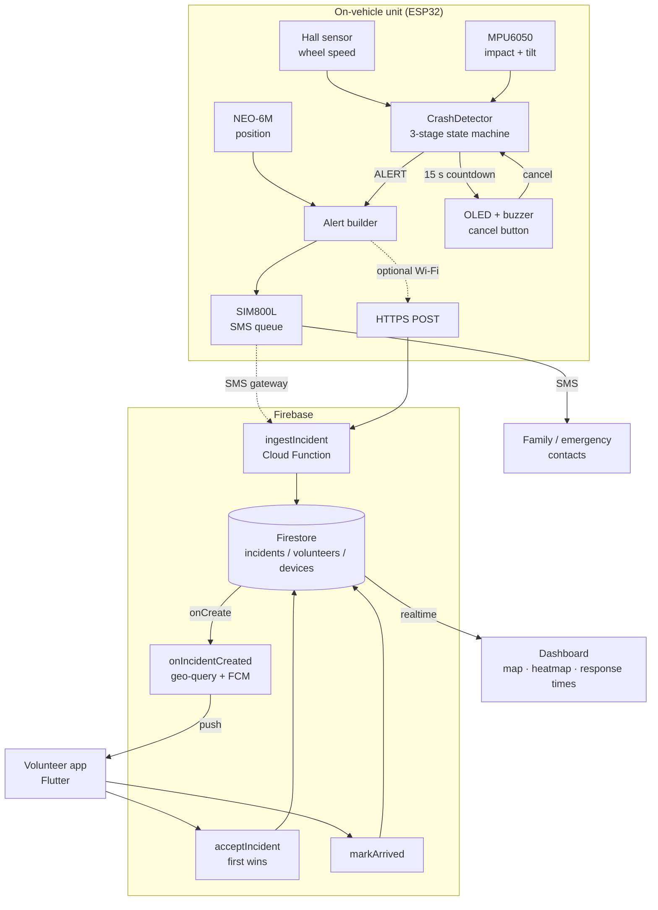
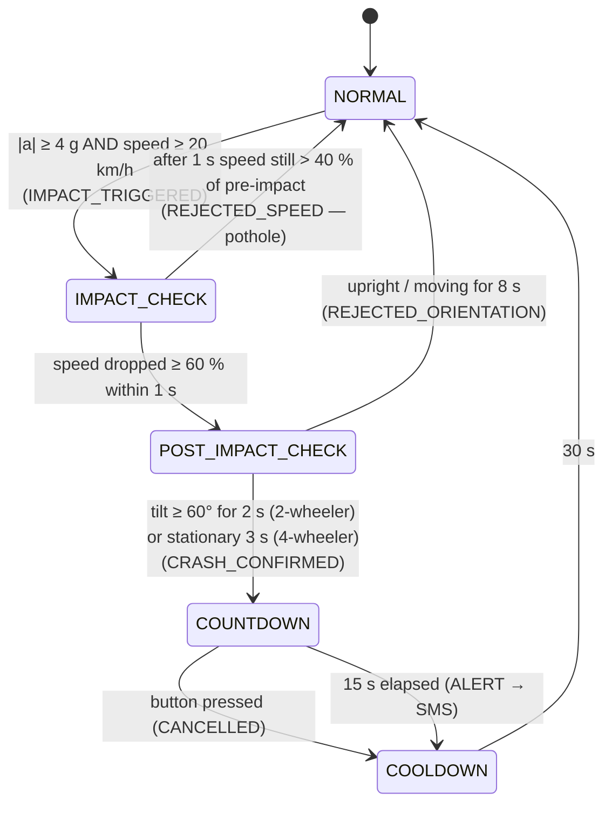
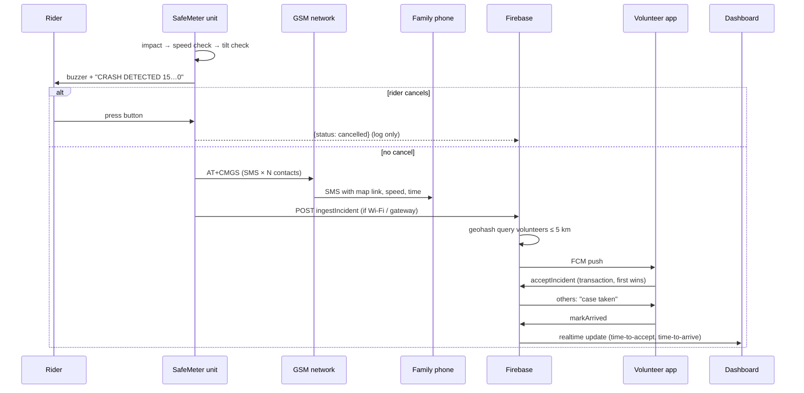

# System architecture

## Overview

**Design principle — SMS first.** The life-critical path (device → SMS → family/emergency
numbers) needs only 2G voice/SMS coverage and no app, phone or internet. Everything in the cloud
is an *addition* (volunteer layer, analytics); if it is down, riders are still protected.

## Detection state machine

Implementation: [`firmware/lib/CrashDetector/CrashDetector.cpp`](../firmware/lib/CrashDetector/CrashDetector.cpp)
(hardware-independent, unit-tested in [`firmware/test/test_native`](../firmware/test/test_native/test_crash_detector.cpp)).

## Alert sequence

## Timing budget (target)

| Step | Target | Notes |
|------|--------|-------|
| Impact → crash confirmed | ≤ 3.5 s | 1 s speed window + 2 s tilt hold |
| Cancel window | 15 s | fixed |
| SMS composed → delivered | 5 – 20 s | depends on network |
| **Impact → family phone** | **≈ 25 – 40 s** | |
| Push → volunteer accept | measured in pilot | |

## Repository map

| Directory | Component | Language / stack |
|-----------|-----------|------------------|
| `firmware/` | ESP32 unit | C++ (PlatformIO, Arduino framework) |
| `backend/` | Cloud Functions, Firestore rules | Node.js 20, Firebase |
| `volunteer-app/` | Responder app | Flutter / Dart |
| `dashboard/` | Incident dashboard | Static HTML + Leaflet + Firebase JS |
| `tools/` | Data logger, analysis | Python |
| `hardware/` | BOM, wiring, rig | Markdown |
| `docs/` | Concept + prototype docs, plans | Markdown + original PDFs |
