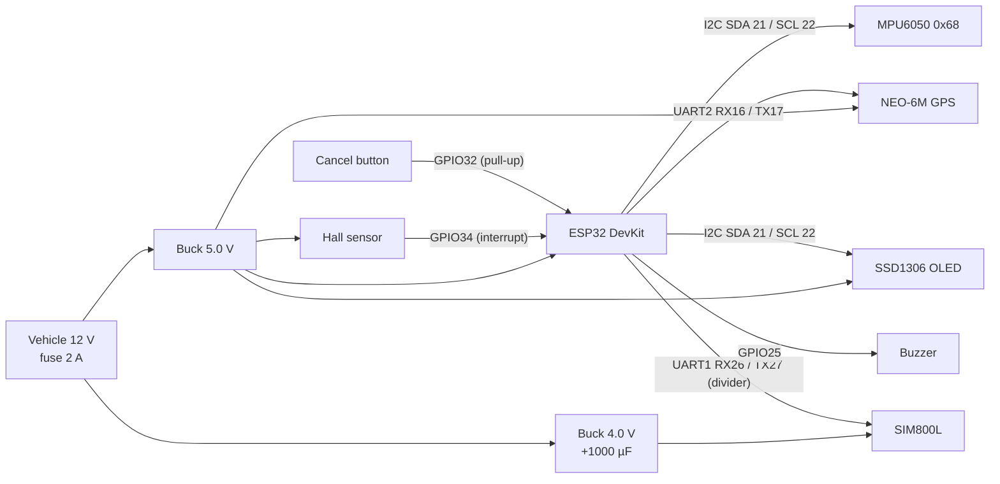

# Wiring guide

Pins below match `firmware/include/config.h`. Adjust both together if your board differs.

## Pin map

| ESP32 pin | Connects to | Notes |
|-----------|-------------|-------|
| GPIO 21 (SDA) | MPU6050 SDA, OLED SDA | 4.7 kΩ pull-ups usually on the modules already |
| GPIO 22 (SCL) | MPU6050 SCL, OLED SCL | |
| GPIO 16 (RX2) | GPS **TX** | GPS runs at 3.3 V logic — direct |
| GPIO 17 (TX2) | GPS **RX** | only needed if you configure the GPS |
| GPIO 26 (RX1) | SIM800L **TXD** | SIM800L TX is ~2.8 V, ESP32 reads it fine |
| GPIO 27 (TX1) | SIM800L **RXD** via 10 kΩ / 20 kΩ divider | 3.3 V → ~2.2 V; SIM800L RX max is 2.8 V |
| GPIO 34 | Hall sensor OUT | **Input-only pin, no internal pull-up** → add 10 kΩ to 3.3 V |
| GPIO 32 | Cancel button → GND | Internal pull-up enabled in firmware |
| GPIO 25 | Buzzer + (active buzzer) | Use a transistor if the buzzer draws > 12 mA |
| 3V3 | MPU6050 VCC, OLED VCC | |
| 5V / VIN | from 5 V buck | ESP32 DevKit's own LDO makes 3.3 V |
| GND | **common ground for everything** | including both bucks and the SIM800L |

## Power — the two things that break student builds

1. **Power the SIM800L separately.** It wants 3.4 – 4.4 V (4.0 V ideal) and pulls bursts of up
   to ~2 A during transmission. Powering it from the ESP32 3.3 V pin or a weak 5 V rail causes
   brown-outs and random resets exactly when you try to send the SMS. Use a dedicated buck set
   to 4.0 V with a **1000 µF** low-ESR capacitor soldered as close to the module's VCC/GND as
   possible. Keep the power wires short and thick (≥ 22 AWG).

2. **Common ground + level shifting.** All modules must share ground. The ESP32 TX (3.3 V) going
   into the SIM800L RX needs a divider (10 kΩ series, 20 kΩ to ground) or a proper level shifter.

Also:

- Put a **2 A fuse** on the 12 V feed and an inline switch for the bench.
- Set the 5 V buck under load (ESP32 + GPS + OLED ≈ 300 mA peak with Wi-Fi off).
- A vehicle's 12 V can spike to 40 V+ at startup (load dump). For road use, add a TVS diode
  (SMBJ24A) and a 100 µF cap before the bucks.

## Sensor placement

- **MPU6050**: rigidly mounted to the enclosure, enclosure rigidly mounted to the frame or
  speedometer housing. Any rubber mounting dampens exactly the spike we want to measure.
  Orientation doesn't matter — the firmware learns "upright" at boot.
- **Hall sensor**: aligned with the wheel magnet within 2 – 3 mm air gap. Use the fork /
  swingarm with a zip-tie bracket; glue the magnet to a spoke or brake disc bolt.
- **GPS antenna**: facing the sky, not under metal.
- **GSM antenna**: away from the GPS antenna (≥ 5 cm) to avoid desensitising it.

## Bench test rig

See [`test-rig.md`](test-rig.md).
